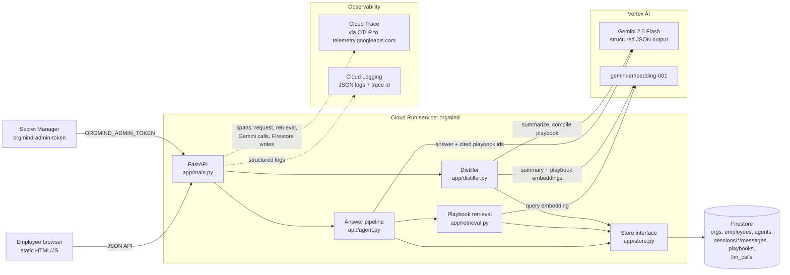

# OrgMind

**Your company's agents learn from each other's conversations.**
Google Cloud AI Builder Cup prototype. Theme: Future of Work & Enterprise Productivity.

## The problem

Enterprises roll out AI agents per team (a Dev agent, an HR agent), but every employee's chat session is a silo.
When five engineers hit the same broken deploy, each one rediscovers the fix, and the knowledge they piece
together dies in their chat history. The next new hire gets the same generic (sometimes invented) advice.

## What OrgMind does

1. **Agents per team.** Each team gets bundled agents (Dev Agent, HR Agent) built on Gemini.
2. **Distiller.** It reads sessions across employees, summarizes each one, and clusters problems that recur
   across **different employees**. Each cluster is compiled into a structured **playbook**: title, trigger,
   symptoms and steps.
   - A playbook needs resolved sessions from at least 2 distinct employees. A single person repeating a problem doesn't count.
   - Only resolved sessions contribute steps. Unresolved attempts are linked as context but never become advice.
   - Playbooks generalize. Org-wide facts (commands, portal paths, policy limits) are kept. One person's
     details (names, cost center codes, amounts) are removed and enforced in code.
3. **Retrieval at answer time.** Agents retrieve relevant playbooks (Gemini embeddings) instead of stuffing
   raw chat history into context, and they cite them. Only the current session's history is in context.
4. **Compare view.** The same question goes to the same agent with and without playbooks, side by side.
5. **Observable.** Every request is traced in Cloud Trace, every Gemini call is visible in the in-app Traces view,
   and logs are correlated with traces in Cloud Logging.

The app has two pages: **User** (Chat, plus previews of Connections and Upload) and **Admin** (Knowledge, Traces,
Roadmap, plus previews of what comes next). Hash routes such as `#/admin/knowledge` and `#/user/chat` deep-link
into any tab. All data is synthetic ("Acme Corp").

## What's real vs planned

Same status legend as the in-app **Admin › Roadmap** page. Preview tabs are labelled *Preview · planned*, every
control on them is disabled, and they make no network calls.

| Area | Item | Status |
|---|---|---|
| Users / Teams | Synthetic Acme employees, each with siloed sessions | ✅ Working now |
| Users / Teams | Users & Teams admin, directory sync (*Admin › Users & Teams*) | 🔵 Next version (V2) |
| Agents | Dev Agent and HR Agent on Gemini 2.5 Flash (Vertex AI) | ✅ Working now |
| Agents | Playbook retrieval + citations in answers | ✅ Working now |
| Agents | Agent builder: create / edit agents (*Admin › Agents*) | 🔵 Next version (V2) |
| Agents | MCP server registry (*Admin › MCPs*) | 🔵 Next version (V2) |
| Agents | ADK on Vertex AI Agent Engine | 🟠 December round |
| Agents | Task sub-agents that load skills (*Admin › Skills & Sub-agents*) | 🟠 December round |
| Agents | MCP connections: Jenkins, GitHub, Drive, Slack (*User › Connections*) | 🟠 December round |
| Distillation | Summarize → cluster across employees → compile playbooks | ✅ Working now |
| Distillation | Only resolved sessions give steps; per-person values dropped | ✅ Working now |
| Distillation | Traces: Cloud Trace + in-app trace view (*Admin › Traces*) | ✅ Working now |
| Distillation | Upload local assistant sessions (*User › Upload*) | 🟣 V3 |
| Distillation | PII redaction + review before publish (*Admin › Guardrails*) | 🟣 V3 |
| Playbooks / Skills | Playbooks with sources and versions | ✅ Working now |
| Playbooks / Skills | Compare: with vs without playbooks | ✅ Working now |
| Playbooks / Skills | Skill creation from playbooks | 🟠 December round |

## Architecture



Distill pipeline: **summarize** each new or changed session (cached, run in parallel) → **cluster** per agent
with complete-linkage on embeddings → **gate** (≥ 2 distinct employees with resolved sessions) → **compile**
playbooks in parallel → **match** existing playbooks (update and bump the version) or create new ones.

## Configuration

| Env var | Default | Purpose |
|---|---|---|
| `GOOGLE_CLOUD_PROJECT` | (none) | GCP project for Vertex AI and Firestore |
| `GOOGLE_CLOUD_LOCATION` | `us-central1` | Vertex AI region |
| `ORGMIND_STORE` | `memory` | `memory` (zero setup) or `firestore` |
| `ORGMIND_FIRESTORE_DATABASE` | `(default)` | Firestore database name |
| `ORGMIND_LLM` | `vertex` if project set, else `fake` | `fake` is a deterministic stub for tests and offline UI work |
| `ORGMIND_CHAT_MODEL` | `gemini-2.5-flash` | Chat/summarize/compile model |
| `ORGMIND_EMBED_MODEL` | `gemini-embedding-001` | Embedding model (768 dims) |
| `ORGMIND_CLUSTER_THRESHOLD` | `0.88` | Similarity needed to cluster sessions |
| `ORGMIND_RETRIEVAL_THRESHOLD` | `0.62` | Similarity needed to offer a playbook to the agent |
| `ORGMIND_TRACING` | `off` | `cloudtrace` exports OpenTelemetry spans to Cloud Trace (via OTLP); `off` locally and in tests |
| `ORGMIND_TRACE_CAP` | `500` | Max recorded LLM calls kept for the in-app Traces view |
| `ORGMIND_RAG_PROVIDER` | `off` | Document RAG: `vertex` (GCS + Vertex AI Search), `fake` (in-memory keyword overlap, tests) or `off` (app behaves exactly as without RAG) |
| `ORGMIND_RAG_DATASTORE` | (none) | Discovery Engine data store ID (unstructured, `default_collection`, `default_search` serving config) |
| `ORGMIND_RAG_BUCKET` | (none) | GCS bucket for uploaded documents (`private/{employee_id}/{doc_id}-{filename}`) |
| `ORGMIND_RAG_LOCATION` | `global` | Data store location |
| `ORGMIND_RAG_MIN_SCORE` | `0.25` | Search hits under this `semanticRelevanceScore` count as "not covered" |
| `ORGMIND_SKILL_MIN_SCORE` | `0.6` | Cosine similarity needed to offer an active skill to the agent (measured: related 0.70–0.79, unrelated 0.46–0.57) |
| `ORGMIND_ADMIN_TOKEN` | (none) | Required `X-Admin-Token` for `POST /api/demo/reset`. Reset is **disabled** when unset. On Cloud Run it comes from Secret Manager |

## Run locally

```bash
python3 -m venv .venv && .venv/bin/pip install -r requirements-dev.txt

# Offline, no GCP needed (fake LLM, in-memory store)
.venv/bin/uvicorn app.main:app --port 8080

# Real Gemini (after `gcloud auth application-default login`)
GOOGLE_CLOUD_PROJECT=<project> ORGMIND_ADMIN_TOKEN=<choose-one> .venv/bin/uvicorn app.main:app --port 8080
```

Open http://localhost:8080.

Tests and evals:

```bash
.venv/bin/pytest                                                 # unit + API tests (fake LLM)
GOOGLE_CLOUD_PROJECT=<project> .venv/bin/python -m scripts.eval_questions        # 12 fixed questions, real Gemini
GOOGLE_CLOUD_PROJECT=<project> .venv/bin/python -m scripts.eval_questions --url https://<service-url>
GOOGLE_CLOUD_PROJECT=<project> .venv/bin/python -m scripts.skills_eval           # skill extraction + use, real Gemini
.venv/bin/python -m scripts.rag_smoke --gemini                                     # real Vertex AI Search data store
GOOGLE_CLOUD_PROJECT=<project> .venv/bin/python -m scripts.firestore_persistence_check --database orgmind-test
ORGMIND_ADMIN_TOKEN=<token> .venv/bin/python scripts/demo_flow.py --url <url>     # headless browser demo flow
.venv/bin/python scripts/ui_tabs_check.py --url <url>    # every tab at desktop + phone width, preview rules
```

## Document RAG (Phase 1, `rag-skills` branch)

Employees upload their own documents and agents answer grounded in them, with citations.

- **Upload** `POST /api/rag/docs`: multipart (`employee_id`, `file`, optional `title`; `.txt` `.md` `.pdf`, max 5 MB)
  or JSON `{employee_id, title, text}` (saved as `.txt`). The file goes to GCS under
  `private/{employee_id}/{doc_id}-{filename}`, and a Discovery Engine import starts (`data_schema=content`,
  `INCREMENTAL`). The response has `status=indexing`.
- **List** `GET /api/rag/docs?employee_id=`: the employee's own docs plus `scope=org` docs. Docs still indexing are
  checked against their import operation on read (no background workers).
- **Search** `POST /api/rag/search {employee_id, query}`: Vertex AI Search (10 results, extractive segments +
  snippets), each hit mapped back to `rag_docs` by its GCS URI. Unmapped hits, hits the employee may not see, and hits
  under `ORGMIND_RAG_MIN_SCORE` are dropped; the top 3 are returned.
- **Chat** `POST /api/sessions/{id}/messages` with `use_rag: true`: excerpts are injected after playbooks as
  "Document excerpts", the model answers only from playbooks and excerpts (saying so when they don't cover the
  question), and `cited_doc_ids` is stored on the message. A RAG failure never fails the chat: the answer is generated
  without documents and `rag.error` explains why.
- **Ownership lives in our store** (`rag_docs`), never in the search index. `rag_docs` survives *Reset demo*,
  because its rows own real GCS objects and index documents.
- Spans: `rag.upload`, `rag.import`, `rag.import.status`, `rag.search` (result count, latency, scope-drop count).
- Smoke test against the real data store: `python -m scripts.rag_smoke [--gemini]`.
- To enable on Cloud Run (not done yet), the runtime service account additionally needs `roles/discoveryengine.editor`
  on the project and `roles/storage.objectAdmin` on the bucket.

## Skills (Phase 2, `rag-skills` branch)

Three kinds of knowledge, kept distinct in code and docs:

| | What it is | Built from | Visible to |
|---|---|---|---|
| **Playbook** (`app/distiller.py`) | Org-wide fix for one recurring problem | Resolved sessions of **2+ employees** hitting the same problem | Everyone (per agent) |
| **RAG doc** (`app/rag_docs.py`) | Raw uploaded source material, searched at answer time | An employee's upload | Owner, or everyone if `scope=org` |
| **Skill** (`app/skills.py`) | A reusable procedure **one** employee's agent worked out in **one** conversation | One session | Owner (`scope=org` sharing arrives in Phase 4) |

- **Extract** `POST /api/skills/extract {session_id, employee_id}` (session owner only, at least 4 messages): one
  Gemini call returns 0–2 skills (name, description, trigger, steps, parameters as names only, evidence message
  indexes). The writer only extracts confirmed procedures, keeps org-wide facts and turns personal values into
  `{parameters}`. Deterministic post-checks reject skills without valid evidence or with secret-like strings
  (AWS keys, bearer tokens, emails, long hex/base64) and redact values the model itself flagged as personal.
  Re-extracting replaces the session's **draft** skills only. New skills are `scope=private`, `status=draft`.
- **Review** `GET /api/skills?employee_id=` (own skills + active org skills; drafts only to their owner),
  `POST /api/skills/{id}/approve` (draft → active), `/archive`, and `PATCH /api/skills/{id}` (name, description,
  steps; bumps `version`). Owner only.
- **Use** `use_skills: true` on the messages endpoint: the top 2 **active** skills for this agent kind visible to
  the employee, above `ORGMIND_SKILL_MIN_SCORE`, go into a "Skills you have learned" block (after playbooks, before
  document excerpts). The agent gives the steps and asks only for the listed parameters; `cited_skill_ids` is stored
  on the message. Failures degrade to an answer without skills.
- Spans: `skills.extract` (proposed/saved/rejected/redacted counts, latency) and `skills.retrieve` (candidates,
  kept, top score). Extraction calls appear in `llm_calls` as `extract_skills`.

## Seed and reset

- On startup the app seeds Acme Corp **only if the store is empty**: 8 employees, Dev + HR agents and
  15 scripted sessions. Those include a recurring vault-token problem (3 resolved, 1 unresolved), a stipend
  problem raised by 3 employees, a problem one employee repeated, a recurring problem nobody solved (Kafka),
  some unrelated noise, and Dana's BigQuery session (`ses_seed_14`, one employee working out a reusable procedure:
  the skill-extraction demo; it forms no cluster and no playbook).
- Summaries, clusters and playbooks are always computed live by Gemini. Nothing is pre-baked.
- **Reset demo** (top-right button, or `curl -X POST -H "X-Admin-Token: $ORGMIND_ADMIN_TOKEN" <url>/api/demo/reset`)
  wipes sessions and playbooks and re-seeds.

## Deploy (Cloud Run)

```bash
gcloud run deploy orgmind --source . --region us-central1 \
  --service-account orgmind-runtime@<project>.iam.gserviceaccount.com \
  --allow-unauthenticated --min-instances 0 --max-instances 1 \
  --set-env-vars "^@^ORGMIND_STORE=firestore@ORGMIND_LLM=vertex@ORGMIND_FIRESTORE_DATABASE=(default)@GOOGLE_CLOUD_PROJECT=<project>@GOOGLE_CLOUD_LOCATION=us-central1@ORGMIND_TRACING=cloudtrace" \
  --set-secrets ORGMIND_ADMIN_TOKEN=orgmind-admin-token:latest
```

The runtime service account needs `roles/aiplatform.user`, `roles/datastore.user`, `roles/cloudtrace.agent`,
`roles/logging.logWriter`, and `roles/secretmanager.secretAccessor` on the `orgmind-admin-token` secret.

## Demo script (3–4 min)

Before each take: **Reset demo** (top right, admin token). The app opens on **Admin › Knowledge** (Compare).

1. **The silo (Admin › Knowledge).** Pick *Dev Agent* and click the first preset, *"My staging deploy is failing
   with ACME_VAULT_TOKEN expired."* The left answer is generic, and Gemini often invents an `acme vault login`
   command. The right answer says *"No playbook matched"*. There's no org knowledge yet.
2. **Distill.** Click **Distill sessions** in the *Org knowledge* panel. While it runs (10–55s) the button counts
   seconds and the report shows *Summarizing sessions → clustering → writing playbooks*. The report then shows
   15 sessions, 4 recurring clusters and per-phase timings:
   - **created**: vault-token playbook (Priya, Marcus, Sofia resolved it; Tom didn't)
   - **skipped**: Docker builds, *resolved by only one employee*
   - **skipped**: Kafka lag, *recurring, but nobody has resolved it yet*
   - **created**: home-office stipend playbook (3 employees)
3. **Ask again.** Click the same preset. The right side now gives the real Acme fix: VPN → `acme auth refresh --vault`
   → `staging-deployers` via #platform-access → `ACME_VAULT_ROLE` for CI. It cites the playbook.
4. **Provenance.** Click the citation chip. The playbook shows its trigger and steps, and which employees it was
   distilled from. Tom's unresolved session is flagged *not used for steps*.
5. **No false matches.** Click the third preset (*"image not found in registry"*). It uses the same command but has
   a different error. The playbook is retrieved but **not** applied, so it cites nothing.
6. **New hire (User › Chat, `#/user/chat`).** You're signed in as *Dana Kim (new hire)*. Start a conversation and ask
   about the vault error, then follow up with *"I ran acme auth refresh --vault on the VPN, but acme deploy staging
   still says vault permission denied. Which group do I need and how do I request access?"* The agent continues from
   the playbook's `staging-deployers` step.
7. **HR, without leaking.** Switch to *Noah Fischer* + *HR Agent* and ask about a rejected home-office stipend. The
   answer gives the AcmePeople path, the *Remote Work Stipend* category and the $500 limit. It never mentions another
   employee's cost center.
8. **Under the hood (Trace button / Admin › Traces).** Each request shows its Gemini calls with model, latency,
   tokens and the playbooks used; *Cloud Trace ↗* opens the full span tree.
9. **What's next (Admin › Roadmap).** Working now vs V2, V3 and the December round.

## Observability

- **Cloud Trace.** With `ORGMIND_TRACING=cloudtrace`, each chat, distill and compare request produces one trace
  (OpenTelemetry). Child spans cover playbook retrieval, every Gemini generate/embed call (model, latency, token
  usage, playbooks used) and Firestore writes. On Cloud Run the spans join the platform's request trace. Spans are
  flushed before the response returns, because Cloud Run throttles CPU afterwards (about 50–100ms per request).
  Tracing is optional and can never fail a request.
- **Export goes through OTLP.** The standard Cloud Trace exporter (`opentelemetry-exporter-gcp-trace` /
  `CloudTraceSpanExporter`, now deprecated) silently dropped our spans: none arrived in Cloud Trace. OrgMind
  therefore exports over **OTLP/gRPC to `telemetry.googleapis.com`** (the Telemetry API), Google's recommended
  ingestion path.
- **Cloud Logging.** On Cloud Run, logs are JSON lines with `severity` and `logging.googleapis.com/trace`, so each
  request summary and LLM-call log links to its trace.
- **In-app traces.** Every LLM call is also recorded (operation, model, latency, tokens, playbook IDs, error and a
  truncated prompt/response excerpt) in a capped `llm_calls` collection. You can see them at
  `GET /api/traces?limit=50`, in **Admin › Traces** and in the **Trace** drawer on both pages, with links to Cloud
  Trace.

## Security

- **Admin token in Secret Manager.** `POST /api/demo/reset` requires `X-Admin-Token`. On Cloud Run the token is
  mounted from Secret Manager (`--set-secrets ORGMIND_ADMIN_TOKEN=orgmind-admin-token:latest`, `secretAccessor`
  only for the runtime service account) instead of a plain env var. Reset is disabled when the token is unset.
- **Synthetic data only.** No real people or credentials. The distiller already removes per-person values (names,
  cost centers, amounts) from playbooks, enforced in code.
- **Deferred to V3:** PII redaction before sessions reach the distiller, and a human review step before a
  playbook publishes (both previewed in *Admin › Guardrails*).
- Public demo: chat, compare and distill are unauthenticated and call Gemini; `--max-instances 1` caps spend.

## Known limitations

- **Live Distill can take 20–55s.** Most calls are fast (~1s per summary), but in traces a few `summarize` calls
  take ~20s. That is most likely Vertex AI rate-limit (429) retries with backoff during the parallel summarize
  burst. The UI shows an elapsed timer while it runs. Tuning summarize concurrency and retry/backoff is planned.

## Roadmap

- **Next version (V2):** Users & Teams admin with directory sync, an agent builder, and an MCP server registry.
- **V3:** guardrails (PII redaction, review before publish) and upload of local assistant sessions.
- **December (final) round:** move agents to **ADK on Vertex AI Agent Engine** with sub-agents, **MCP connections**
  (Jenkins, GitHub, Google Drive, Slack), **upload** of external sessions (pulled forward from V3), and
  **skill creation** from playbooks.
- Also planned: tuning summarize concurrency and retry/backoff for faster Distill, per-team access control on
  playbooks, and feedback signals (did the playbook help?) to rank and retire playbooks.
