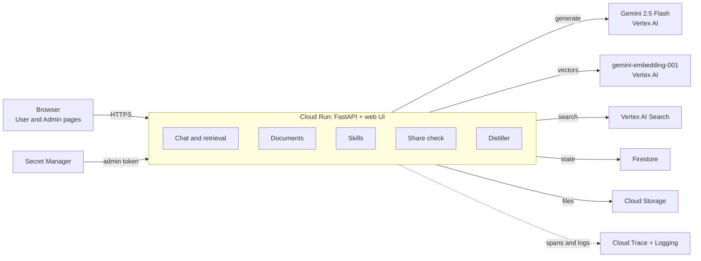
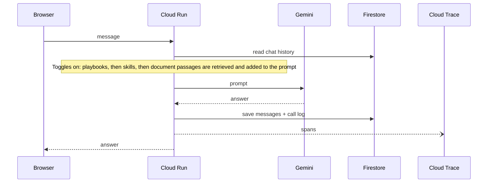
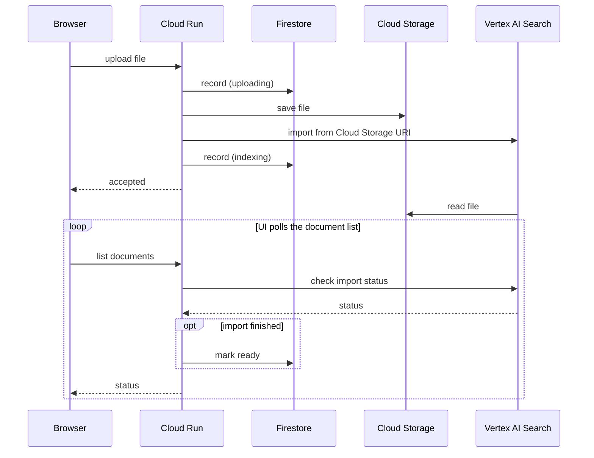
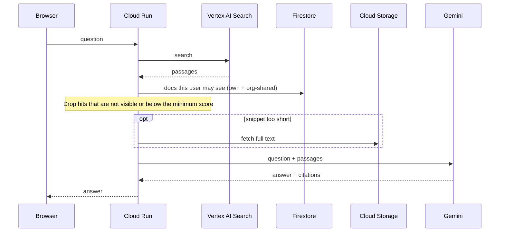
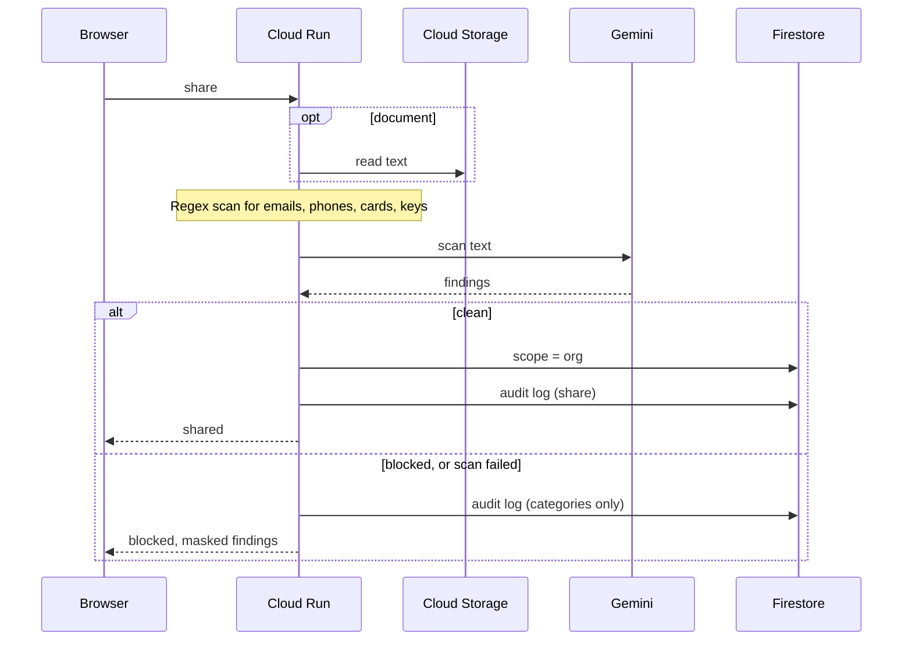
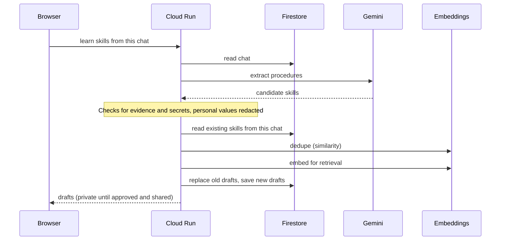
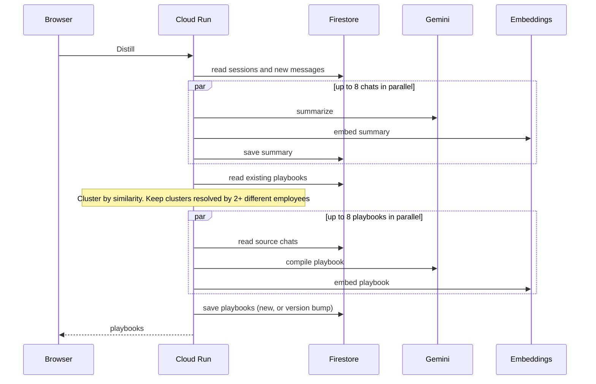

# OrgMind

**An org-wide knowledge layer for AI agents: what one employee works out, every colleague's agent can reuse.**

**Live demo:** https://orgmind-207900876373.us-central1.run.app

> Synthetic data only. Daily usage caps apply, so the demo may pause when the cap is reached.

## The problem

Company knowledge sits in silos: team wikis, private documents and individual chat histories. The same problem gets
solved again and again by different people, because nobody can see that a colleague already fixed it. Even LLM
assistants grounded on internal data stay isolated per user, so what one conversation works out is lost to the next.

OrgMind is an org-wide layer that learns from what people do and shares it back.

## What it does today

- **Documents (RAG):** employees upload files, and agents answer from them with citations (Vertex AI Search).
- **Skills:** an agent learns a reusable procedure from one employee's chat. It stays a private draft until the owner approves it.
- **Playbooks:** the distiller finds problems that two or more employees resolved separately and compiles them into one cited fix.
- **Guarded sharing:** documents and skills can be shared org-wide only after an automatic PII and secret check (regex detectors plus Gemini).
- **Agents:** a Dev agent and an HR agent on Gemini Flash. Playbooks, Skills and Documents are per-chat toggles.
- **Compare:** the same question side by side, answered without and with org knowledge.
- **Traces:** every request is traced in Cloud Trace, and every Gemini call shows in the in-app Traces view.

## Architecture



*One Cloud Run service serves the API and the UI. Gemini, embeddings, search, storage and observability are managed Google Cloud services.*



*Chat message: only the current chat's history goes into the prompt, along with any knowledge retrieved through the toggles.*



*Document upload and index: the file goes to Cloud Storage and Vertex AI Search imports it from there. Status is checked on each list request; there is no background worker.*



*Document question: the search index knows nothing about owners. Visibility is enforced in Cloud Run against Firestore after the search.*



*Sharing with the org: both checks must come back clean in the same request. If the Gemini check fails, nothing is shared.*



*Skill learning: a skill the employee already learned from the same chat is reported as "already learned" and is not saved again.*



*Distill: only resolved chats contribute steps, and summaries are cached, so a re-run only summarizes new or changed chats.*

## Run locally

Offline (fake LLM, in-memory store, no GCP account needed):

```bash
python3 -m venv .venv && .venv/bin/pip install -r requirements-dev.txt
.venv/bin/uvicorn app.main:app --port 8080        # http://localhost:8080
```

Real Gemini (after `gcloud auth application-default login`):

```bash
GOOGLE_CLOUD_PROJECT=<project> ORGMIND_ADMIN_TOKEN=<choose-one> \
  .venv/bin/uvicorn app.main:app --port 8080
# add ORGMIND_STORE=firestore for Firestore, and the RAG variables below for documents
```

| Group | Env var | Default | Purpose |
|---|---|---|---|
| GCP | `GOOGLE_CLOUD_PROJECT` | (none) | Project for Vertex AI and Firestore. Without it the app runs in fake-LLM mode |
| GCP | `GOOGLE_CLOUD_LOCATION` | `us-central1` | Vertex AI region |
| GCP | `ORGMIND_STORE` | `memory` | `memory` (zero setup) or `firestore` |
| GCP | `ORGMIND_FIRESTORE_DATABASE` | `(default)` | Firestore database id |
| GCP | `ORGMIND_ADMIN_TOKEN` | (none) | Needed for *Reset demo*; reset is disabled when unset. On Cloud Run it comes from Secret Manager |
| GCP | `ORGMIND_TRACING` | `off` | `cloudtrace` exports spans to Cloud Trace over OTLP |
| Models | `ORGMIND_LLM` | `vertex` if a project is set, else `fake` | `fake` is a deterministic stub for tests and offline UI work |
| Models | `ORGMIND_CHAT_MODEL` | `gemini-2.5-flash` | Chat, summarize, compile, skill extraction, share check |
| Models | `ORGMIND_EMBED_MODEL` | `gemini-embedding-001` | Embeddings (768 dimensions) |
| Retrieval | `ORGMIND_CLUSTER_THRESHOLD` | `0.88` | Similarity needed to cluster chats in Distill |
| Retrieval | `ORGMIND_RETRIEVAL_THRESHOLD` | `0.62` | Similarity needed to offer a playbook to the agent |
| Retrieval | `ORGMIND_SKILL_MIN_SCORE` | `0.6` | Similarity needed to offer a skill to the agent |
| RAG | `ORGMIND_RAG_PROVIDER` | `off` | `vertex` (Cloud Storage + Vertex AI Search), `fake` (tests) or `off` |
| RAG | `ORGMIND_RAG_DATASTORE` | (none) | Vertex AI Search data store id |
| RAG | `ORGMIND_RAG_BUCKET` | (none) | Cloud Storage bucket for uploaded documents |
| RAG | `ORGMIND_RAG_LOCATION` | `global` | Data store location |
| RAG | `ORGMIND_RAG_MIN_SCORE` | `0.25` | Search hits below this score count as not covered |
| Cost caps | `ORGMIND_LIMITS` | `on` | Daily global and hourly per-IP caps; `off` in tests and evals |
| Cost caps | `ORGMIND_LIMIT_<BUCKET>` | e.g. `GEMINI_CALLS` 600 | Per-UTC-day caps; buckets and defaults are in `app/config.py` |

## Tests

```bash
.venv/bin/pytest -q          # 151 tests, fake LLM + in-memory store, no GCP needed
```

Evals and browser checks against real Gemini and Vertex AI Search (Chromium via `.venv/bin/playwright install chromium`):

```bash
GOOGLE_CLOUD_PROJECT=<project> .venv/bin/python -m scripts.eval_questions    # playbook answers, leak checks
GOOGLE_CLOUD_PROJECT=<project> .venv/bin/python -m scripts.skills_eval       # skill extraction and use
GOOGLE_CLOUD_PROJECT=<project> .venv/bin/python -m scripts.guardrail_eval    # share check
.venv/bin/python -m scripts.rag_smoke --gemini                                 # Vertex AI Search data store
.venv/bin/python scripts/ui_tabs_check.py --url <url>                          # every tab, desktop and phone width
```

## Deploy on Cloud Run

```bash
gcloud run deploy orgmind --source . --region us-central1 \
  --service-account orgmind-runtime@<project>.iam.gserviceaccount.com \
  --allow-unauthenticated --min-instances 0 --max-instances 1 \
  --set-env-vars "^@^ORGMIND_STORE=firestore@ORGMIND_LLM=vertex@ORGMIND_FIRESTORE_DATABASE=(default)@GOOGLE_CLOUD_PROJECT=<project>@GOOGLE_CLOUD_LOCATION=us-central1@ORGMIND_TRACING=cloudtrace" \
  --set-secrets ORGMIND_ADMIN_TOKEN=orgmind-admin-token:latest
```

To add documents to an existing service, use `--update-env-vars` (`--set-env-vars` drops the rest):
`ORGMIND_RAG_PROVIDER=vertex,ORGMIND_RAG_DATASTORE=<data store id>,ORGMIND_RAG_BUCKET=<bucket>,ORGMIND_RAG_LOCATION=global,ORGMIND_RAG_MIN_SCORE=0.25`.
To try a revision before it serves traffic, add `--no-traffic --tag <name>` and use the tagged URL.

The runtime service account needs `roles/aiplatform.user`, `roles/datastore.user`, `roles/cloudtrace.agent`,
`roles/logging.logWriter` and `roles/secretmanager.secretAccessor` on the secret. For documents it also needs
`roles/discoveryengine.editor` on the project and `roles/storage.objectAdmin` on the bucket.

## Real vs planned

| Area | Working now | Planned (December round) |
|---|---|---|
| Knowledge | Documents RAG, skills, playbooks | Self-improving agents and sub-agents |
| Sharing | Guarded org-wide sharing (regex + Gemini, fail closed) | QA model + human reviewer for shared items, Cloud DLP |
| Agents | Dev and HR agents, Compare view | Google ADK on Agent Engine, MCP connectors |
| Operations | Cloud Trace, in-app Traces, daily usage caps | Sign-in and per-org isolation |
| Models | Gemini 2.5 Flash on Vertex AI for chat, summaries, skills and scans (chosen for the prototype because the demo data is simple and the behaviour is easy to follow) | Newer Gemini models such as 3.8 Flash for harder, real-world cases, adopted after evals |

Honest limits:
- All data is synthetic (the fictional company "Acme Corp").
- There is no sign-in. The "Viewing as" switch is a demo convenience, not access control.
- The automatic PII and secret check is a safety net, not a guarantee.
- The prototype runs on Gemini 2.5 Flash for demo convenience. The approach is model-agnostic, and newer Gemini models are planned for the next version.

Demo preparation, the recording setup and a walkthrough script are in [docs/DEMO.md](docs/DEMO.md).
