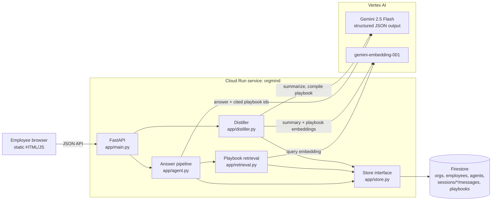

# OrgMind

**Your company's agents learn from each other's conversations.**
Google Cloud AI Builder Cup prototype. Theme: Future of Work & Enterprise Productivity.

## The problem

Enterprises roll out AI agents per team (a Dev agent, an HR agent), but every employee's chat session is a silo.
When five engineers hit the same broken deploy, each one rediscovers the fix, and the knowledge they piece
together dies in their chat history. The next new hire gets the same generic (sometimes invented) advice.

## What OrgMind does

1. **Agents per team.** Each team gets bundled agents (Dev Agent, HR Agent) built on Gemini.
2. **Distiller.** It reads sessions across employees, summarizes each one, and clusters problems that recur
   across **different employees**. Each cluster is compiled into a structured **playbook**: title, trigger,
   symptoms and steps.
   - A playbook needs resolved sessions from at least 2 distinct employees. A single person repeating a problem doesn't count.
   - Only resolved sessions contribute steps. Unresolved attempts are linked as context but never become advice.
   - Playbooks generalize. Org-wide facts (commands, portal paths, policy limits) are kept. One person's
     details (names, cost center codes, amounts) are removed and enforced in code.
3. **Retrieval at answer time.** Agents retrieve relevant playbooks (Gemini embeddings) instead of stuffing
   raw chat history into context, and they cite them. Only the current session's history is in context.
4. **Compare view.** The same question goes to the same agent with and without playbooks, side by side.

All data is synthetic ("Acme Corp").

## Architecture



Distill pipeline: **summarize** each new or changed session (cached, run in parallel) → **cluster** per agent
with complete-linkage on embeddings → **gate** (≥ 2 distinct employees with resolved sessions) → **compile**
playbooks in parallel → **match** existing playbooks (update and bump the version) or create new ones.

## Configuration

| Env var | Default | Purpose |
|---|---|---|
| `GOOGLE_CLOUD_PROJECT` | (none) | GCP project for Vertex AI and Firestore |
| `GOOGLE_CLOUD_LOCATION` | `us-central1` | Vertex AI region |
| `ORGMIND_STORE` | `memory` | `memory` (zero setup) or `firestore` |
| `ORGMIND_FIRESTORE_DATABASE` | `(default)` | Firestore database name |
| `ORGMIND_LLM` | `vertex` if project set, else `fake` | `fake` is a deterministic stub for tests and offline UI work |
| `ORGMIND_CHAT_MODEL` | `gemini-2.5-flash` | Chat/summarize/compile model |
| `ORGMIND_EMBED_MODEL` | `gemini-embedding-001` | Embedding model (768 dims) |
| `ORGMIND_CLUSTER_THRESHOLD` | `0.88` | Similarity needed to cluster sessions |
| `ORGMIND_RETRIEVAL_THRESHOLD` | `0.62` | Similarity needed to offer a playbook to the agent |
| `ORGMIND_ADMIN_TOKEN` | (none) | Required `X-Admin-Token` for `POST /api/demo/reset`. Reset is **disabled** when unset |

## Run locally

```bash
python3 -m venv .venv && .venv/bin/pip install -r requirements-dev.txt

# Offline, no GCP needed (fake LLM, in-memory store)
.venv/bin/uvicorn app.main:app --port 8080

# Real Gemini (after `gcloud auth application-default login`)
GOOGLE_CLOUD_PROJECT=<project> ORGMIND_ADMIN_TOKEN=<choose-one> .venv/bin/uvicorn app.main:app --port 8080
```

Open http://localhost:8080.

Tests and evals:

```bash
.venv/bin/pytest                                                 # unit + API tests (fake LLM)
GOOGLE_CLOUD_PROJECT=<project> .venv/bin/python -m scripts.eval_questions        # 12 fixed questions, real Gemini
GOOGLE_CLOUD_PROJECT=<project> .venv/bin/python -m scripts.eval_questions --url https://<service-url>
GOOGLE_CLOUD_PROJECT=<project> .venv/bin/python -m scripts.firestore_persistence_check --database orgmind-test
```

## Seed and reset

- On startup the app seeds Acme Corp **only if the store is empty**: 8 employees, Dev + HR agents and
  14 scripted sessions. Those include a recurring vault-token problem (3 resolved, 1 unresolved), a stipend
  problem raised by 3 employees, a problem one employee repeated, a recurring problem nobody solved (Kafka)
  and some unrelated noise.
- Summaries, clusters and playbooks are always computed live by Gemini. Nothing is pre-baked.
- **Reset demo** (top-right button, or `curl -X POST -H "X-Admin-Token: $ORGMIND_ADMIN_TOKEN" <url>/api/demo/reset`)
  wipes sessions and playbooks and re-seeds.

## Deploy (Cloud Run)

```bash
gcloud run deploy orgmind --source . --region us-central1 \
  --service-account orgmind-runtime@<project>.iam.gserviceaccount.com \
  --allow-unauthenticated --min-instances 0 --max-instances 1 \
  --set-env-vars "ORGMIND_STORE=firestore,ORGMIND_LLM=vertex,ORGMIND_FIRESTORE_DATABASE=(default),GOOGLE_CLOUD_PROJECT=<project>,GOOGLE_CLOUD_LOCATION=us-central1,ORGMIND_ADMIN_TOKEN=$ORGMIND_ADMIN_TOKEN"
```

The runtime service account needs `roles/aiplatform.user` and `roles/datastore.user`.

## Demo script (3–4 min)

1. **The silo (Compare tab).** Pick *Dev Agent* and click the first preset, *"My staging deploy is failing with
   ACME_VAULT_TOKEN expired."* The left answer is generic, and Gemini even invents an `acme vault login`
   command. The right answer says *"No playbook matched"*. There's no org knowledge yet.
2. **Distill.** Click **Distill sessions** in *Org knowledge*. The report shows 14 sessions and 4 recurring clusters:
   - **created**: vault-token playbook (Priya, Marcus, Sofia resolved it; Tom didn't)
   - **skipped**: Docker builds, *resolved by only one employee*
   - **skipped**: Kafka lag, *recurring, but nobody has resolved it yet*
   - **created**: home-office stipend playbook (3 employees)
3. **Ask again.** Click the same preset. The right side now gives the real Acme fix: VPN → `acme auth refresh --vault`
   → `staging-deployers` via #platform-access → `ACME_VAULT_ROLE` for CI. It cites the playbook.
4. **Provenance.** Click the citation chip. The playbook shows its trigger and steps, and which employees it was
   distilled from. Tom's unresolved session is flagged *not used for steps*.
5. **No false matches.** Click the third preset (*"image not found in registry"*). It uses the same command but has
   a different error. The playbook is retrieved but **not** applied, so it cites nothing.
6. **New hire (Chat tab).** You're signed in as *Dana Kim (new hire)*. Start a conversation and ask about the
   vault error, then follow up with *"I did that but still get permission denied"*. The agent continues from the
   playbook's group-access step.
7. **HR, without leaking.** Switch to *Noah Fischer* + *HR Agent* and ask about a rejected home-office stipend. The answer
   gives the AcmePeople path, the *Remote Work Stipend* category and the $500 limit. It never mentions
   another employee's cost center.

## Roadmap (next version)

- **PII redaction and guardrails** before sessions reach the distiller (names, emails, IDs, secrets), plus
  policy guardrails on agent answers.
- **Human review before playbooks publish.** A team owner approves, edits or rejects a distilled playbook
  (draft → published), with an audit trail.
- Per-team access control on playbooks; feedback signals (did the playbook help?) to rank and retire playbooks.
